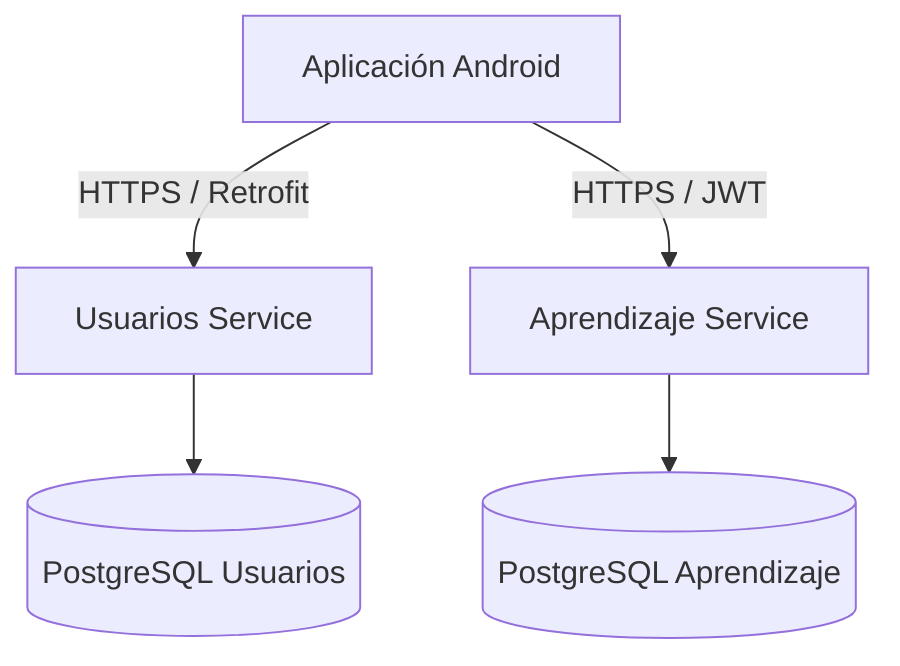

# MPAZ PRO 3.º - Microservicios

Proyecto de Desarrollo de Aplicaciones Móviles (DSY1105).

**Duoc UC - Sede San Bernardo**  
Evaluación Final Transversal (EFT).

## Descripción

MPAZ PRO 3.º es una aplicación educativa orientada a estudiantes de tercero básico de la Escuela Escritora Marcela Paz.

El backend está compuesto por dos microservicios independientes desarrollados con Spring Boot.

Su propósito es proporcionar servicios REST para la autenticación, gestión de usuarios, contenidos educativos, evaluaciones, resultados e informes pedagógicos.

Los servicios están integrados con una aplicación Android desarrollada mediante Kotlin, Jetpack Compose y Retrofit.

El proyecto utiliza exclusivamente usuarios y datos ficticios.

## Integrantes

- Martín Faúndez.
- Joaquín Orellana.
- Vicente Vega.

## Tecnologías utilizadas

| Tecnología | Propósito |
|---|---|
| Java 17 | Lenguaje de programación |
| Spring Boot 3.3.5 | Desarrollo de microservicios |
| Maven | Gestión de dependencias |
| Spring Data JPA | Acceso a datos |
| Spring Security | Seguridad y autorización |
| JWT HS256 | Autenticación |
| BCrypt | Protección de contraseñas |
| H2 | Base de datos local y pruebas |
| PostgreSQL | Persistencia en la nube |
| Docker | Contenedores |
| Render | Despliegue de microservicios |
| Neon | Alojamiento de bases de datos |
| JUnit 5 | Pruebas automatizadas |
| MockMvc | Pruebas de endpoints |
| Git y GitHub | Control de versiones |

## Arquitectura

El backend está compuesto por dos microservicios independientes, cada uno con su propia base de datos.



Los servicios utilizan una configuración compartida para la generación y validación de tokens JWT.

## Estructura del repositorio

```text
MpazPro-microservicios/
├── usuarios-service/
│   ├── src/
│   │   ├── main/
│   │   └── test/
│   ├── Dockerfile
│   └── pom.xml
├── aprendizaje-service/
│   ├── src/
│   │   ├── main/
│   │   └── test/
│   ├── Dockerfile
│   └── pom.xml
├── CONTRATO_API.md
└── README.md
```

## Microservicio Usuarios

Responsabilidades:

- Autenticación mediante RUT, contraseña y rol.
- Administración de usuarios.
- Generación de tokens JWT.
- Validación de credenciales.
- Protección de contraseñas mediante BCrypt.
- Restricción de endpoints según los permisos del perfil.

Puerto local: 8081.

URL de despliegue:

https://mpaz-usuarios-service.onrender.com/

## Microservicio Aprendizaje

Responsabilidades:

- Administración de objetivos de aprendizaje.
- Gestión de contenidos educativos.
- Aprobación y rechazo de contenidos por UTP.
- Gestión de preguntas y evaluaciones.
- Registro y corrección de respuestas.
- Control de intentos.
- Seguimiento del rendimiento.
- Generación y validación de informes pedagógicos.

Puerto local: 8082.

URL de despliegue:

https://mpaz-aprendizaje-service.onrender.com/

## Perfiles de usuario

### Estudiante

- Consulta objetivos de aprendizaje asignados.
- Visualiza contenidos aprobados.
- Responde desafíos y evaluaciones.
- Consulta sus propios resultados.

### Docente

- Administra objetivos, contenidos y preguntas.
- Configura intentos de evaluación.
- Consulta resultados de estudiantes.
- Genera y valida informes pedagógicos.

### Jefatura UTP

- Administración de usuarios según los permisos del backend.
- Consulta de información curricular.
- Revisión de contenidos educativos.
- Aprobación o rechazo de contenidos.

## Entornos de ejecución

| Característica | Entorno local | Entorno nube |
|---|---|---|
| Ejecución | Spring Boot | Docker en Render |
| Base de datos | H2 | PostgreSQL en Neon |
| Comunicación | HTTP local | HTTPS |
| Usuarios | Datos de prueba | Datos ficticios de demostración |
| Configuración | Perfil local o predeterminado | Perfil cloud |

## Bases de datos

Los microservicios utilizan bases de datos independientes.

### Usuarios

Almacena información relacionada con:

- Usuarios.
- Credenciales protegidas.
- Roles y perfiles.

### Aprendizaje

Almacena información relacionada con:

- Objetivos de aprendizaje.
- Contenidos educativos.
- Preguntas.
- Respuestas.
- Intentos de evaluación.
- Resultados e informes pedagógicos.

H2 se utiliza para el desarrollo local y las pruebas automatizadas.

PostgreSQL proporciona persistencia en el entorno desplegado en la nube.

## Despliegue en la nube

Los dos microservicios se encuentran desplegados en Render mediante Docker.

Cada servicio utiliza una base de datos PostgreSQL independiente alojada en Neon.

```text
Render
├── mpaz-usuarios-service
└── mpaz-aprendizaje-service

Neon
├── mpaz-usuarios
└── mpaz-aprendizaje
```

Cada microservicio dispone de un Dockerfile y una configuración específica para el perfil cloud.

Los archivos de configuración de la nube se encuentran en:

```text
usuarios-service/src/main/resources/application-cloud.properties
aprendizaje-service/src/main/resources/application-cloud.properties
```

Las credenciales de PostgreSQL, contraseñas de demostración y claves de autenticación se configuran mediante variables de entorno.

Los valores privados no se incluyen en GitHub.

## Configuración de seguridad JWT

Ambos microservicios utilizan la variable de entorno:

```text
MPAZ_JWT_SECRET
```

El valor debe corresponder a una clave Base64 de al menos 32 bytes una vez decodificada.

Los dos servicios deben utilizar la misma clave para permitir la validación de los tokens.

La clave debe mantenerse privada.

## Autenticación

La aplicación Android inicia sesión mediante el endpoint:

```http
POST /api/auth/login
```

Ejemplo de estructura de solicitud:

```json
{
  "rut": "123456785",
  "password": "CONTRASENA_DE_DEMOSTRACION",
  "rol": "DOCENTE"
}
```

El microservicio de usuarios valida las credenciales y genera un token JWT cuando la autenticación es correcta.

El token se utiliza para acceder a los endpoints protegidos mediante el encabezado:

```http
Authorization: Bearer TOKEN_JWT
```

## Endpoints de aprendizaje

Entre los recursos REST disponibles se encuentran:

| Método | Endpoint | Descripción |
|---|---|---|
| GET | /api/objetivos | Consulta de objetivos |
| GET | /api/contenidos | Consulta de contenidos |
| GET | /api/preguntas | Consulta de preguntas |

El contrato completo de los endpoints, permisos, solicitudes y respuestas está documentado en:

```text
CONTRATO_API.md
```

El acceso depende del rol y los permisos del usuario autenticado.

## Usuarios ficticios de demostración

| RUT | Rol |
|---|---|
| 123456785 | DOCENTE |
| 134567899 | UTP |
| 111111111 | ESTUDIANTE |
| 222222222 | ESTUDIANTE |

Las credenciales del entorno desplegado se configuran mediante variables de entorno y se entregan de manera privada al evaluador.

Las contraseñas históricas de prueba local no deben utilizarse como credenciales del entorno de la nube.

## Datos iniciales

El sistema incorpora material educativo de demostración.

- 4 objetivos de aprendizaje.
- 5 contenidos educativos.
- 16 preguntas.
- 4 asignaturas.
- 4 usuarios ficticios.

Los registros iniciales pueden ampliarse mediante las funcionalidades de administración de la aplicación.

Las referencias curriculares deben contrastarse con el Currículum Nacional del Ministerio de Educación de Chile.

## Ejecución local

### Requisitos

- Java 17 o JDK compatible.
- Maven.
- IntelliJ IDEA u otro entorno de desarrollo.
- Git.

### Clonar el repositorio

```bash
git clone https://github.com/mwrtinn/MpazPro-microservicios.git
```

### Configurar los servicios

1. Abrir el repositorio en IntelliJ IDEA.
2. Importar ambos proyectos Maven.
3. Configurar MPAZ_JWT_SECRET en ambos microservicios.
4. Utilizar la misma clave de desarrollo local.
5. Ejecutar UsuariosServiceApplication.
6. Ejecutar AprendizajeServiceApplication.

Las variables adicionales del entorno cloud deben configurarse conforme a los archivos application-cloud.properties cuando se utilice dicho perfil.

### Direcciones locales

Desde el computador:

```text
Usuarios: http://localhost:8081
Aprendizaje: http://localhost:8082
```

Desde el emulador de Android Studio:

```text
Usuarios: http://10.0.2.2:8081
Aprendizaje: http://10.0.2.2:8082
```

HTTP se utiliza exclusivamente en el entorno local de desarrollo.

## Ejecución mediante Internet

La aplicación Android puede conectarse directamente a los microservicios desplegados.

```text
https://mpaz-usuarios-service.onrender.com/
https://mpaz-aprendizaje-service.onrender.com/
```

No es necesario mantener los microservicios locales ejecutándose para utilizar el entorno remoto.

La comunicación con los servicios desplegados utiliza HTTPS.

## Integración con Android

La aplicación Android utiliza Retrofit y OkHttp para consumir los endpoints REST.

El proceso general de integración comprende:

1. Inicio de sesión.
2. Recepción del token JWT.
3. Incorporación del token a las solicitudes protegidas.
4. Comunicación con el microservicio de aprendizaje.
5. Procesamiento de respuestas.
6. Actualización de los estados de interfaz.

Repositorio Android:

https://github.com/mwrtinn/MpazPro

La aplicación también incorpora la API externa de iNaturalist como recurso educativo complementario.

Esta API se consume desde la aplicación móvil.

## Pruebas automatizadas

| Microservicio | Pruebas aprobadas |
|---|---:|
| usuarios-service | 12 |
| aprendizaje-service | 14 |
| Total backend | 26 |

La aplicación Android incorpora adicionalmente 147 pruebas unitarias.

El total del proyecto corresponde a 173 pruebas automatizadas aprobadas.

### Aspectos evaluados

- Autenticación.
- Validación de credenciales.
- Autorización por roles.
- Seguridad JWT.
- Operaciones REST.
- Gestión de contenidos.
- Registro de respuestas.
- Control de intentos.
- Gestión de informes pedagógicos.

Las pruebas utilizan bases de datos H2 en memoria para evitar modificar la información persistente del entorno desplegado.

### Ejecutar pruebas

Desde IntelliJ IDEA, seleccionar el proyecto Maven correspondiente y ejecutar:

```text
Maven -> Lifecycle -> clean -> test
```

También es posible ejecutar desde la terminal de cada microservicio, si Maven está instalado:

```bash
mvn clean test
```

## Seguridad

- Autenticación mediante JWT.
- Firma de tokens mediante HS256.
- Contraseñas protegidas mediante BCrypt.
- Tokens con duración de una hora.
- Validación de firma, emisor, audiencia y vencimiento.
- Autorización por roles.
- Restricción de acceso a resultados de otros estudiantes.
- Informes pedagógicos exclusivos del docente.
- Consola web H2 deshabilitada.
- Comunicación HTTPS en la nube.
- Credenciales privadas mediante variables de entorno.
- Bases de datos independientes.

Estas medidas corresponden al alcance de un prototipo académico y no constituyen una certificación de seguridad para producción.

## Control de versiones

Repositorio:

https://github.com/mwrtinn/MpazPro-microservicios

Ramas:

- main: versión principal integrada y rama predeterminada.
- feature/usuarios-service: desarrollo de usuarios.
- feature/aprendizaje-service: desarrollo de aprendizaje.
- feature/despliegue-nube: configuración Docker y PostgreSQL.

Se utilizan commits descriptivos para registrar las etapas de implementación, pruebas, documentación y despliegue.

Las ramas de desarrollo se conservan como evidencia académica.

## Estado del proyecto

### Backend

- [x] Microservicio de usuarios.
- [x] Microservicio de aprendizaje.
- [x] Bases de datos independientes.
- [x] Autenticación JWT.
- [x] Autorización por perfiles.
- [x] Endpoints REST.
- [x] Pruebas automatizadas.
- [x] Configuración Docker.
- [x] Persistencia PostgreSQL.
- [x] Despliegue mediante Render.
- [x] Bases de datos alojadas en Neon.

### Aplicación móvil

- [x] Integración mediante Retrofit.
- [x] Consumo de microservicios remotos.
- [x] Consumo de API externa.
- [x] Pruebas unitarias.
- [x] Cobertura de instrucciones de lógica superior al 80 %.
- [x] Generación de APK firmado.
- [x] Registro del paquete Android.
- [x] Instalación en dispositivo físico.

## Limitaciones conocidas

El proyecto utiliza planes gratuitos de alojamiento.

Los servicios pueden entrar en estado de inactividad y presentar demoras al recibir una nueva solicitud.

Las cuotas, disponibilidad y condiciones de Render y Neon dependen de sus respectivos proveedores.

El acceso remoto requiere conexión a Internet.

El proyecto debe someterse a pruebas adicionales de seguridad, rendimiento y concurrencia antes de utilizarse en un entorno real.

## Finalidad académica

MPAZ PRO corresponde a un proyecto académico desarrollado para la asignatura Desarrollo de Aplicaciones Móviles de Duoc UC.

Los datos utilizados son ficticios.

Los informes pedagógicos describen resultados registrados y no constituyen diagnósticos profesionales ni decisiones académicas automáticas.
